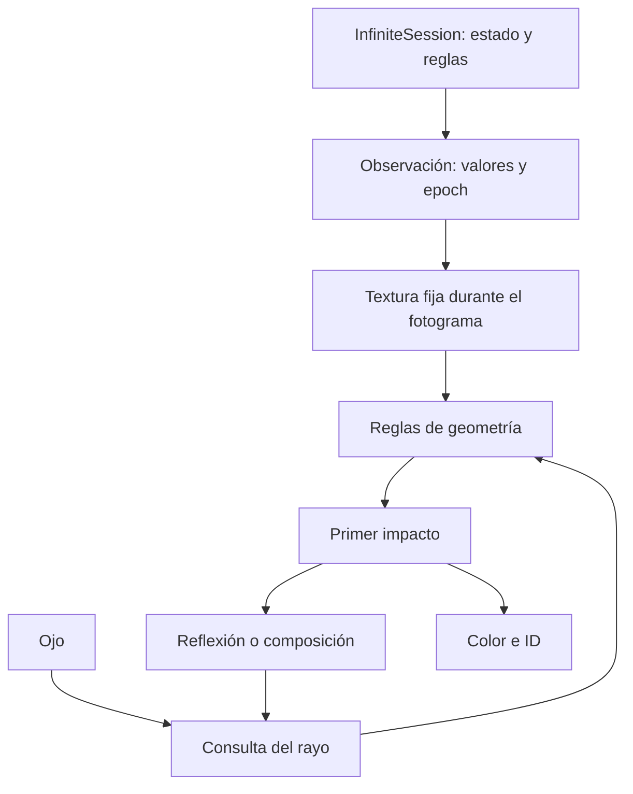

# Espejos sobre el mismo mundo de reglas

## Referencia y resultado

Implementación del renderizador, sin continuar el trabajo de Solar.

- Referencia recuperable: `d7592bb87ae4285161b958939efa292850158726`.
- Rama: `codex/ether-mirror-render-20261020`.
- Render y pruebas: `92561d91d3ae5c23eeea3f8653223e963aef7120`.
- Integración Android: `95721e741a587ecafe39da87f47538050bf9fdcb`.
- La corrección Android posterior conserva el programa original si el controlador rechaza compilar los reflejos. Sus fuentes se volvieron a compilar; ver `results/ether-mirror-validation-2026-10-20/android-compile.json`.
- Las 35 ramas remotas no cambiaron respecto a la referencia anterior. El PR #25 continúa siendo la base remota `aab0930378796ebfd42f9629e2575108ca94fcff`; estos commits son locales. No se fusionó ni publicó una rama.

El motor ofrece suelo reflectante y dos espejos enfrentados. Los objetos vistos
por reflexión conservan sus IDs: seleccionar una imagen reflejada selecciona
su objeto de origen. Ocultarlo y restaurarlo actualiza sus reflejos.

En el caso extremo con un objeto, la referencia recorrió **42.732 reflexiones**
y encontró el objeto 0. La ruta nueva encontró el mismo objeto con **dos consultas
a la escena**. Al ocultarlo, otro recorrido de **114.583 reflexiones** terminó en
el suelo, también con dos consultas. Una consulta contiene cálculos geométricos;
esto no significa dos instrucciones de máquina ni una aceleración universal.

## Conexión con Ether



`QuantumScene.compile` y `QuantumRenderer.sync` siguen tomando una observación
del núcleo. Todos los rebotes usan los mismos coeficientes, tiempo, semilla y
ediciones. Una puerta puede cambiar la geometría reflejada; observarla conserva
el estado nativo. La prueba con Ether aplica Z en la dirección 63 y comprueba
el cambio de imagen, la conservación del estado al observar y la invalidación
tras restaurarlo.

El nuevo bloque óptico pertenece al observador gráfico. Ether suministra los
parámetros del mundo; el cálculo de intersecciones y reflexión se ejecuta en
GLES. No se crearon sesiones, qubits, texturas de objetos ni mundos adicionales
por cada imagen reflejada.

## Representación e intersecciones

Para una cuadrícula de lado `side`, se define `a = 1.1 * side + 2.2`.
El suelo está en `y = -0.025`, dentro de `[-a,a]` en X y Z. Los espejos verticales
están en `x = -a` y `x = a`, con Z en `[-a,a]` e Y entre `-0.025` y `8`.
Su altura permanece fija al editar objetos. Son espejos planos ideales, con
reflectancia configurable de 0 a 1; no se implementó dispersión rugosa.

El rayo conserva origen, dirección, longitud recorrida, peso y contadores.
La búsqueda de cajas conserva las reglas y el recorrido DDA del motor. Al
alcanzar un espejo se refleja su dirección y continúa usando la misma escena.
La profundidad de pantalla corresponde a la primera superficie; el ID de
selección corresponde al objeto visible al final del recorrido.

Hay dos formas de evitar repetir rebotes:

1. **Tramos certificados vacíos.** Reflejar en X no modifica Y ni Z. Se obtiene
   la primera entrada posible al volumen que contiene todos los objetos y el
   suelo. Antes de esa entrada, del borde del panel y del plano lejano se
   componen cruces completos, conservando la paridad y la coordenada exacta del
   espejo. Se deja un margen numérico antes del siguiente evento.
2. **Intersección con repeticiones periódicas.** Para una caja cuyo intervalo X
   es `[l,u]`, todas sus imágenes se describen por dos familias:
   `[l,u] + 4ak` y `[2a-u,2a-l] + 4ak`, para enteros k. El intervalo de tiempo
   permitido por Y/Z permite encontrar la primera ocurrencia X válida sin
   visitar las imágenes intermedias. Se comprueban todas las cajas físicas de
   las filas Z alcanzables, incluidas sus excepciones y su altura actual.

La segunda ruta se elige para caminos de al menos cuatro cruces y hasta 4.096
candidatos físicos en las filas alcanzables. Si el presupuesto de candidatos no
alcanza, se conserva el recorrido iterativo. Esta elección limita el coste de
una consulta; no elimina cajas del mundo.

## Precisión, terminación y memoria

- El presupuesto configurable de 1 a 64 cuenta **rebotes explícitos**, no los
  cruces resueltos por composición. El valor inicial es 16.
- Un recorrido que agota ese presupuesto produce un marcador magenta. La
  lectura/exportación de una imagen incompleta falla explícitamente. En Android
  se puede aumentar el presupuesto desde el control de espejos; un marcador no
  se interpreta como un ID seleccionable.
- El plano lejano limita la longitud óptica total, igual que un límite de vista
  sobre el mundo desplegado. Se conserva el fondo al recortar esa longitud.
- Una órbita exactamente horizontal y cerrada, cuya trayectoria completa se
  comprueba vacía, adopta la solución negra de radiancia mínima. Un recinto
  perfecto sin fuentes no determina una radiancia inicial única.
- La composición usa `highp` de GLES. Se conserva un umbral de seguridad de
  `2^23` cruces por composición; fuera de él se vuelve a la ruta comprobada.
  Las pruebas realizadas llegan a 114.583 reflexiones, no a todo ese umbral.
- En aristas de cajas, varias normales pueden describir el mismo impacto. La
  ruta de reflejos resuelve empates entre tiempos de cara dentro de `1e-5`
  unidades del rayo, sin cambiar el tiempo de intersección. La cara inferior
  fija su coordenada local Y a cero antes de evaluar el patrón del material.
- El suelo reflejado emplea una huella analítica del píxel: las derivadas de
  pantalla dentro de un bucle divergente no son una base válida para el filtrado.
  Las exportaciones por regiones usan el origen global del píxel.

La RAM por recorrido no crece con la cantidad de reflejos representados. Se
mantienen los buffers de la imagen, el código compilado, las excepciones y los
coeficientes existentes. El controlador puede reservar memoria propia: se midió
el RSS del proceso además de identificar las estructuras de la aplicación.

Cada proceso de pruebas se limitó a **2 GiB de espacio virtual**, con presupuesto
de CPU de 55 segundos y, en la campaña principal, 60 segundos de pared por caso.
Esto es distinto de certificar el consumo global de una APK en un teléfono de
2 GB. El máximo RSS fue **137.044 KiB (133,83 MiB)**. En 64 ciclos de creación,
renderizado y cierre, el pico fue **118.424 KiB**; el RSS después del cierre pasó
de 115.708 KiB tras ocho ciclos a 118.300 KiB al terminar los 64, estabilizándose
al final de esta campaña. No se presenta esto como una prueba ilimitada de fugas.

## Evidencia ejecutada

Informe íntegro: `results/ether-mirrors-2026-10-20.json`. Cada resultado incluye
el controlador, los presupuestos, las muestras y hashes de las fuentes.

| Comprobación | Resultado |
| --- | --- |
| Oráculo independiente: hash entero, cajas explícitas y rebotes en float64 | 7.814 rayos; 2.521 impactos en objetos reflejados; cero diferencias de ID y número de rebotes entre los casos completados |
| Composición frente a recorrido iterativo en 16 escenas | Cero diferencias de color en los píxeles completados por ambas rutas; la nueva ruta completó todas las imágenes |
| Cámara virtual, con recorrido primario y el mismo material | 36.833 píxeles reflejados; cero diferencias de ID; diferencia máxima de 1/255 por canal |
| Recorrido vacío con espejos | 104.167 reflexiones, resueltas en tres consultas |
| Objeto alcanzado después de muchos reflejos | 171, 1.710, 17.093 y 42.732 reflexiones; dos consultas por caso |
| Objeto ocultado en el caso largo | 114.583 reflexiones hasta el suelo; dos consultas |
| Ether vivo | Lectura sin mutación, caché exacta, selección/ocultación/restauración, cambio por puerta e invalidación por epoch |
| Exportación por regiones | Cuatro imágenes, color e IDs, sin diferencias respecto al framebuffer completo |
| Modo original | 6.912.000 píxeles sin diferencias; shader preprocesado idéntico a la referencia |
| Entradas inválidas | 11 configuraciones rechazadas antes de modificar la configuración anterior |
| Creación y cierre | Ocho ciclos en la campaña principal y 64 en la campaña prolongada |
| Android | 13 fuentes de producción e instrumentación compiladas contra API 35; verificación de tipos, no ejecución Android |
| Núcleo nativo | Procedencia verificada; sus fuentes permanecen iguales a la referencia ya validada |

Los píxeles que la referencia iterativa no completa se contabilizan
explícitamente en el JSON. No se incluyen como coincidencias de color. La prueba
de velocidad siguiente usa imágenes que **ambas rutas completan**.

## Rendimiento observado

Controlador: Mesa llvmpipe por software. Las medianas excluyen la primera vista;
se alternan las dos implementaciones con la misma cámara, resolución, material
y semilla. Cada nueva vista vuelve a dibujarse, sin caché de respuestas.

| Misma imagen con espejos, 320 × 180 | Mediana |
| --- | ---: |
| Rebotes uno por uno | 11,105 ms |
| Composición habilitada | 2,736 ms |
| Cociente de tiempos | 4,06× |

Se compararon 518.400 píxeles en esa prueba, sin diferencias. Es una carga con
repeticiones regulares; no representa la aceleración de todos los fotogramas.

Añadir reflejos sigue teniendo un coste. Con las mismas cámaras y tiempos:

| Objetos y resolución | Sin espejos | Suelo | Dos espejos |
| --- | ---: | ---: | ---: |
| 1.024; 320 × 180 | 4,052 ms | 5,080 ms | 5,549 ms |
| 1.048.576; 640 × 360 | 22,341 ms | 26,575 ms | 24,904 ms |

La refactorización inicial ralentizó el modo original. Se descartó esa
especialización compartida y se conservó el programa primario original,
compilando la variante óptica por separado y bajo demanda. No se atribuye una
mejora de velocidad al modo apagado; sus diferencias de tiempo cambian de signo
entre tamaños y el código preprocesado es idéntico.

## Uso y repetición

Desde la raíz del repositorio, con Python, NumPy, Pillow, un compilador C++/cpp
y EGL/GLES 3:

```sh
python -m pip install -r graphics-desktop/requirements.txt
OPENBLAS_NUM_THREADS=1 LP_NUM_THREADS=1 python tools/ether_mirror_check.py
python results/ether-mirror-validation-2026-10-20/lifetime_campaign.py
```

La imagen entregada `espejos-ether.png` procede de una sesión Ether viva. Se
puede reconstruir con:

```sh
OPENBLAS_NUM_THREADS=1 LP_NUM_THREADS=1 python graphics-desktop/demo.py \
  --infinite zero --objects 64 --command h_all --command cz_neighbors \
  --view mirror --mirrors pair --cosmic-style --width 960 --height 540 \
  --export-project mundo-espejos.cosmic --output espejos-ether.png
```

Para observar el proyecto guardado:

```sh
python graphics-desktop/demo.py --project mundo-espejos.cosmic \
  --mirrors pair --mirror-budget 16 --cosmic-style --output reflejo.png
```

`--mirrors floor` activa el suelo; `--mirrors off` recupera la vista original.
`--no-mirror-fold` selecciona la referencia iterativa. La API Python es
`renderer.set_reflections(mode, budget=16, fold=True, reflectance=1.)`, con modos
0, 1 y 2 respectivamente. `engine.observe` incluye esta configuración y la
presentación en su clave de reutilización.

En Graphics/COSMIC recompilados, el botón **Espejos** ofrece suelo, pareja y
presupuesto. El estado se conserva en la sesión Android. Los formatos `.cosmic`
v1/v2 continúan guardando el mundo y la cámara; los ajustes ópticos son
preferencias del observador y se indican por separado al abrir el proyecto.
El informe de la CLI conserva esos ajustes para reproducir la imagen.

La compilación APK mantiene el procedimiento del repositorio, con JDK 17,
Gradle 8.9, plataforma/build-tools 35, NDK 27.2.12479018 y CMake 3.22.1:

```sh
gradle -p graphics-android --no-daemon :app:assembleDebug :app:assembleDebugAndroidTest
adb install -r graphics-android/app/build/outputs/apk/debug/app-debug.apk
adb install -r graphics-android/app/build/outputs/apk/androidTest/debug/app-debug-androidTest.apk
adb shell am instrument -w -e mirrors true \
  com.mundox.graphics.test/com.mundox.graphics.GraphicsInstrumentation
```

La prueba Android añadida verifica selección reflejada, restauración del objeto,
serialización óptica, conservación del núcleo y PNG por regiones. Está preparada
y compilada, **pendiente de ejecución en emulador y dispositivo**. Para comprobar
la evidencia completa del perfil del emulador existente, el verificador admite
`--mirrors`, combinable con `--uhd4k` o `--ultra8k`. La entrega no contiene una APK
nueva ni mediciones del Samsung.

## Cobertura y siguiente frontera

| Ruta | Estado de esta entrega |
| --- | --- |
| `graphics-desktop/shaders/{eye.frag,common.glsl}` | Reflejos, reglas periódicas, normales, profundidad y materiales ejecutados |
| Copias en `graphics-android/app/src/main/assets/shaders/` | Idénticas a escritorio; el contenido se ejecutó en GLES del anfitrión |
| `graphics-desktop/{renderer.py,engine.py,demo.py}` | Configuración, caché, selección y CLI ejecutadas |
| `QuantumRenderer.java`, `MainActivity.java` | Integración, sesión y recuperación ante rechazo del shader revisadas y compiladas; ejecución móvil pendiente |
| `GraphicsInstrumentation.java`, `graphics-verify-evidence.py` | Caso opcional y validación estricta de evidencia preparados; ejecución Android pendiente |
| `tools/ether_mirror_check.py` | Oráculos, límites, tiempos, píxeles, integración y memoria ejecutados |
| Graphics/COSMIC | Consumidores de las fuentes compartidas al recompilar |
| PC | Conserva la API compartida; su interfaz no activa automáticamente este nuevo modo |
| Solar | Trabajo detenido; no hay cambios de Solar en estos commits |

La descripción de las repeticiones puede crecer sin crear copias del mundo.
El coste pendiente depende de las cajas físicas candidatas, de la precisión
numérica y del recorrido que la consulta necesite resolver. Las cotas actuales
no demuestran rendimiento constante para cualquier escena.

La siguiente mejora estructural es una jerarquía conservadora de intervalos de
ocupación y altura, construida sólo para las regiones consultadas e invalidada
con sus cambios. Permitiría resolver caminos que hoy exceden los 4.096
candidatos sin recorrer regiones vacías ni almacenar matrices por objeto.
Espejos inclinados, superficies curvas, rugosidad e iluminación indirecta
requieren reglas adicionales y sus propias referencias; esta entrega implementa
los dos modos planos descritos arriba.
