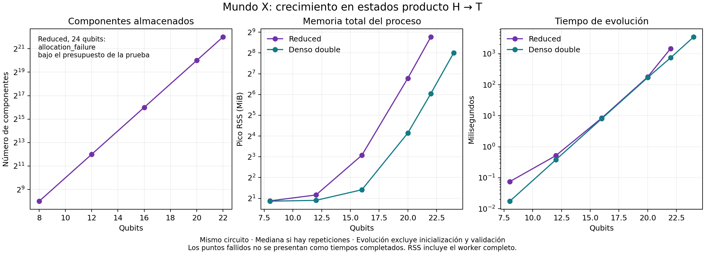

# Mundo X: límites medidos y mejoras — 17 de octubre de 2026

La creación y evolución de Reduced Exact T se aceleraron aproximadamente **2–2,25 veces** en
los tres circuitos comparados, conservando el número de componentes y su carga
lógica. El crecimiento del mapa continúa siendo exponencial: incluso un estado
producto de 22 qubits ocupó 4.194.304 componentes y 435,3 MiB de RAM. Con 24 qubits
esa familia agotó el presupuesto de memoria de la prueba.

Se evaluó la versión publicada `f858053bf0a47e6c760428f3526ec74ff89e40c3` y un
candidato en la rama local `codex/architecture-limits-20261017`. Las pruebas
adicionales del propietario que todavía no aparecen en el repositorio quedan
fuera de esta evaluación. La copia original, sus resultados y sus procesos se
conservaron; los cambios se prepararon en un worktree separado.

## Cómo leer el experimento

Hay tres preguntas diferentes:

1. **¿Calcula bien?** Se compara el estado con una referencia independiente.
2. **¿Cuánto cuesta?** Se miden evolución, inicialización y memoria por separado.
3. **¿Por qué crece?** Se varían qubits y circuitos, observando componentes y
   estructura; una cifra de qubits aislada no responde esta pregunta.

Cada worker de escala tuvo un máximo de **15 segundos de pared y 1,5 GiB de
espacio virtual**. No se intentó agotar la RAM de la máquina. Los workers se
ejecutaron con un bloqueo compartido para evitar interferencias entre pruebas.
Un timeout indica una frontera del presupuesto utilizado, no una imposibilidad
matemática ni un tamaño máximo universal.

Entorno: Linux x86-64, g++ 14.2.0, cuatro CPU asignadas y 16 GiB de memoria del
contenedor. Compilación de escala: C++17, `-O3 -DNDEBUG`. Las verificaciones
numéricas independientes usaron NumPy `complex128`. No se verificó una nueva
compilación Android ni Windows; sí se incorporaron los tests a sus workflows.

Los tiempos del banco de escala excluyen inicialización, reconstrucción densa y
validación. Se conserva el tiempo de inicialización como otro campo. El pico RSS
incluye el proceso completo. `logical_payload_bytes` excluye gastos del mapa,
capacidades y asignador; no se presenta como RAM total.

## Resultados de escala



La familia producto prepara H y T en cada qubit. Sus qubits permanecen
independientes, pero Reduced materializa un coeficiente por cada combinación.
Esto revela un límite de la representación elegida incluso en estados con una
descripción compacta sencilla.

| Caso del candidato | Componentes Reduced | Pico RSS | Evolución |
|---|---:|---:|---:|
| Producto H,T, 16 qubits | 65.536 | 8,4 MiB | 8,38 ms |
| Producto H,T, 20 qubits | 1.048.576 | 110,0 MiB | 177,30 ms |
| Producto H,T, 22 qubits | 4.194.304 | 435,3 MiB | 1.464,12 ms |
| Producto H,T, 24 qubits | Sin ejecución completada | Llegó al presupuesto | Fallo de reserva |
| Clifford+T aleatorio, 16 qubits | 65.536 | 10,7 MiB | 569,42 ms |
| Patrón del CLI, 16 qubits | 65.536 | 10,7 MiB | 872,92 ms |

Los puntos de 16 qubits son medianas de tres repeticiones. Los puntos mayores
usan una ejecución por presupuesto. En el caso aleatorio de 16 qubits, el vector
denso independiente double tardó 45,42 ms; en el patrón CLI, 38,43 ms. La mejora
del candidato frente al original no implica que gane frente al denso.

El banco completo produjo **138 observaciones**: 109 ejecuciones completadas, un
rechazo esperado de 64 qubits, un fallo de reserva, ocho timeouts y 19 tamaños
omitidos después de encontrar una frontera. Las comprobaciones pequeñas se
realizaron en procesos separados de los benchmarks.

Fronteras registradas:

- Reduced, producto H,T: fallo de reserva a 24 qubits bajo 1,5 GiB.
- Reduced, producto H,T,T: timeout a 24 qubits.
- Reduced, familias aleatoria y CLI: timeout a 20 qubits con `4*n` puertas T.
- Denso double: completó el producto de 24 qubits; timeout a 26. En las familias
  aleatoria y CLI llegó al timeout a 24.
- Compact, GHZ: completó 10.000 qubits en 682,35 ms de evolución, con 23,97 MiB
  de estado lógico y aproximadamente 26 MiB de RSS. A 32.000 qubits superó los
  15 segundos. Una repetición instrumentada confirmó que la evolución todavía
  no había emitido su marcador de finalización. No se atribuye ese timeout
  exclusivamente a la comprobación posterior de la firma.
- Reduced aceptó una evolución dispersa de 63 qubits con cuatro componentes y
  rechazó 64. Es un límite de las máscaras de 64 bits del código, no de la física.

### Un control que ayuda a entender la representación

H,T,T en cada qubit produce el mismo estado que H,S porque `T² = S`.
Reduced siguió usando `2^n` componentes. Una ruta Compact de control, que aplica
esa identidad explícitamente, usó un solo tableau; completó hasta 28 qubits
en este banco. No se incorporó una selección automática de esta ruta a la app.

Esto enseña a distinguir **historias de cálculo**, **componentes de una base** y
**complejidad real del estado**. Muchos componentes en una base concreta no
demuestran que el estado sea difícil para todas las representaciones.

## Mejoras implementadas

### Evolución de Reduced

El perfil del circuito de 14 qubits y 128 T concentró aproximadamente el 77 %
del tiempo propio muestreado en `apply_clifford`. Se hicieron tres cambios:

- Actualizaciones simplécticas directas para conjugar etiquetas Pauli. El trabajo
  de esta operación pasa de recorrer los qubits a unas pocas operaciones de bits.
- Salida rápida cuando la etiqueta ya es canónica.
- Una corrección estabilizadora por puerta T, reutilizada para todo el soporte,
  conservando el orden de multiplicación y las fases.

| Circuito, 128 puertas T | Original | Candidato medido | Mejora |
|---|---:|---:|---:|
| 12 qubits | 220,52 ms | 110,17 ms | 2,00× |
| 14 qubits | 927,67 ms | 411,40 ms | 2,25× |
| 16 qubits | 4.406,49 ms | 2.138,22 ms | 2,06× |

Son medianas de tres ejecuciones del mismo circuito, con iguales flags. Este
microbenchmark incluye creación del objeto y evolución; excluye los oráculos.
Se conservan las 18 mediciones y hashes de
los binarios. No se guardó el hash del código intermedio usado en esa comparación;
la evidencia lo declara. Los cambios posteriores añadieron precisión al oráculo
y pruebas, conservando la ruta optimizada de evolución.

### Una referencia más precisa

H,T alternadas sobre un qubit hicieron que el `DenseCore` original float32
superara error de norma² `3e-5` en la puerta **1.456**. Es un umbral de ese
circuito y plataforma. A 100.000 puertas el error llegó aproximadamente a 0,00212.
Reduced no mostró ese mismo deterioro.

Ahora existe `BasicDenseCore<Real>`. El alias `DenseCore` conserva float32 y sus
bytes históricos; `DenseCore64` usa double. Los oráculos y la reconstrucción de
Reduced usan `DenseCore64`. Su reporte declara `dense_reference_precision_bits=64`
y contabiliza los bytes de esa referencia real. El experimento Exact T original
conserva su referencia float32. El test de 100.000 puertas del nuevo núcleo
double obtuvo error de norma de aproximadamente `1,14e-11`.

### Entradas y tamaños

Se validan dimensiones antes de multiplicar o reservar memoria. Se corrigió un
caso donde `SIZE_MAX * SIZE_MAX` se envolvía y era aceptado como un cluster de
un qubit. Reduced rechaza tamaños inválidos antes de construir el tableau.

La consola rechaza negativos, texto, números parcialmente válidos como `4x`
y enteros fuera de rango, y convierte excepciones en errores con código de
salida. En práctica, `h` sin índice ya no aplica accidentalmente H al qubit cero.

## Verificación

- CTest: **3/3 targets** aprobados. Incluyen 7.081 comprobaciones de estado tras
  cada puerta contra una implementación C++ independiente double, 25 controles
  de límites, el bit 62 y evolución densa larga.
- Referencia NumPy: **77/77** casos profundos del original y **212/212** del
  candidato, estos últimos con tolerancia `1e-9`. Incluyen los 200 casos de la
  revisión anterior y 12 casos profundos, algunos de 100.000 puertas.
- Candidato: máximo error de norma² `3,14e-11` y error L2 `1,57e-11` en ese corpus.
- Las pruebas de medición incluyen expectativas de generadores, rango binario
  completo y conmutación. Verifican las ramas forzadas documentadas, no la calidad
  estadística de un muestreador.
- UBSan pasó en las pruebas de optimización y límites. Los casos de CLI y ocho
  comandos funcionales finales también terminaron con los códigos esperados.

Estas muestras finitas no constituyen una prueba de corrección universal.

## Dos referencias adicionales

Un mismo binario GHZ original, con orden intercalado y tres repeticiones, tardó
219,48 ms a 4.096 qubits y 50,78 ms a 4.097; a 8.192 y 8.193 tardó 630,60 y
366,08 ms. Es compatible con un problema de stride y caché. La causa requiere
un experimento de padding o contadores de hardware; no se modificó el layout.

También se midió Stim 1.16.0, instalado en un entorno aislado. Su GHZ de 10.000
qubits tardó 31,75 ms incluyendo inicialización y evolución, con unos 133 MiB de
RSS. Las verificaciones de Stim fueron observables seleccionados y su RSS incluye
Python y esas comprobaciones. No es una comparación idéntica del costo de
validación con Compact. A 64.000 falló bajo el límite impuesto de 1,5 GiB; eso
no se presenta como límite general ni defecto demostrado de Stim.

## Reproducir y aprender a interpretar el resultado

Primero compilar y verificar el núcleo:

```bash
cmake -S . -B build -DCMAKE_BUILD_TYPE=Release
cmake --build build --parallel 2
ctest --test-dir build --output-on-failure
```

Después ejecutar una escala corta. Elegir directorios nuevos conserva evidencia:

```bash
python3 tools/stress_architecture.py --quick --variants candidate \
  --candidate-repo . --output-dir /tmp/mundox-scale-quick \
  --compute-lock /tmp/mundox-compute.lock

python3 tools/architecture_numerics/stress.py --repo . --suite sanity \
  --tolerance 1e-9 --output-dir /tmp/mundox-numerics \
  --lock-file /tmp/mundox-compute.lock
```

La segunda herramienta requiere NumPy. El banco de escala usa Python y g++.
Las herramientas de recursos están preparadas para Linux.

Para repetir las fronteras de este informe:

```bash
python3 tools/stress_architecture.py --full --variants candidate \
  --candidate-repo . --qubits 8,12,16,20,22,24,26,28 \
  --ghz-qubits 1024,10000,32000,64000 \
  --output-dir /tmp/mundox-scale-full --compute-lock /tmp/mundox-compute.lock
```

Ejercicio: leer `results.csv` y localizar qué crece primero: componentes, RSS o
tiempo. En H,T cada qubit adicional duplica el soporte. Comparar luego H,T,T con
su ruta Compact muestra que cambiar la representación puede aportar más que
optimizar una operación del mapa. Los registros `progress` permiten distinguir
un timeout antes y después de completar la evolución.

## Siguiente experimento acotado

Comparar un selector de backend o una representación factorizada en las familias
producto y Clifford+T dispersas. Definir antes el criterio: resultados dentro de
la tolerancia, menor RSS o menor tiempo total, incluyendo el costo de detectar
estructura y cambiar de representación. La referencia también debe poder
simplificar el circuito. Descartar una estrategia si solo traslada el costo a la
conversión o validación.

Los números y hashes resumidos están en [summary.json](architecture_limits_2026-10-17/summary.json).
La figura se conserva también en [PDF](architecture_limits_2026-10-17/architecture-limits.pdf)
y [SVG](architecture_limits_2026-10-17/architecture-limits.svg). La evidencia cruda
completa se preservó fuera del código, en el directorio de ejecución de la sesión.
