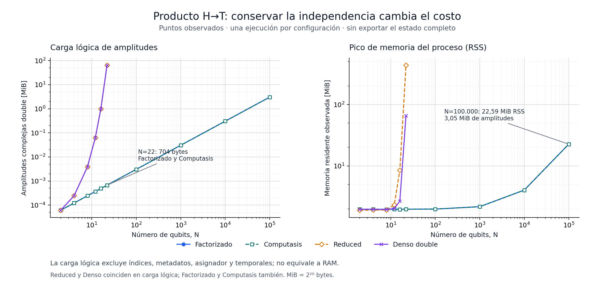
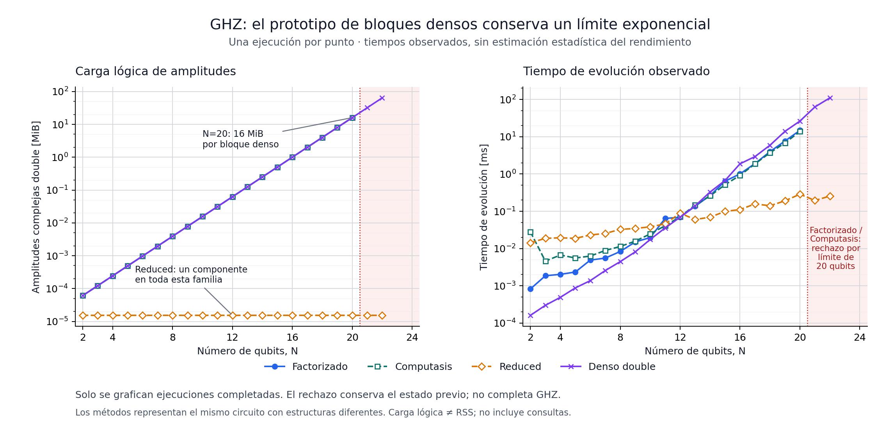
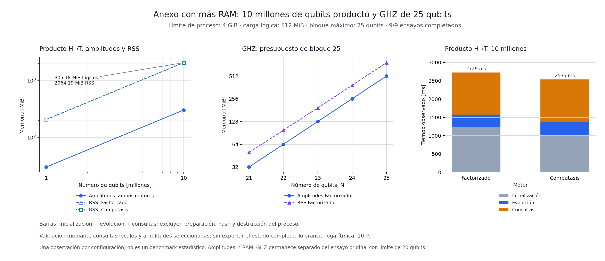

# Mundo X: exámenes de factorización y Computasis

> Registro histórico anterior a la eliminación del controlador. El código activo
> ya no contiene su implementación, comando ni pruebas específicas. Las menciones
> y series con ese nombre identifican mediciones archivadas.

Fecha: 17 de octubre de 2026. Experimento local sobre `14e0bdb`, en la rama
`codex/factorized-exams-20261017`. Se conservan el repositorio original y el
[examen anterior](architecture_limits_2026-10-17.md).

**Resultado:** conservar factores independientes evita la expansión global en
los productos y pares desconectados examinados. El nuevo controlador puede
recuperar estructura después de deshacer conexiones. También encontramos
límites: bloques entrelazados grandes, separaciones que el redondeo impide
certificar y amplitudes globales demasiado pequeñas para `double`.

Estos resultados no certifican una arquitectura perfecta, eficiencia universal,
ventaja cuántica física ni novedad científica. El almacenamiento por productos
tensoriales y bloques densos tiene antecedentes en simulación clásica. Aquí se
implementó y midió una opción concreta para Mundo X; evaluar su originalidad
requiere compararla con trabajos y motores existentes.

## Qué se implementó

- [`FactorizedCore`](../native/include/mundo_x/factorized_core.hpp): vector de
  estado por bloque independiente, índices directos de qubit a bloque, puertas
  H/X/Z/S/T/CX/CZ, consultas locales y amplitudes globales.
- `Computasis` (retirado): controlador de
  presupuesto con umbrales, memoria acotada de cortes, recuperación y contadores.
- Pruebas C++, oráculo NumPy independiente, supervisor de escala y comando
  `computasis-exam`. Las nuevas representaciones son experimentales y no
  sustituyen automáticamente a Compact Core o Reduced Exact T.

Si el estado es un producto de bloques, su representación es

```text
|ψ⟩ = ⊗k |ψ_Bk⟩
amplitudes almacenadas = Σk 2^|Bk|
payload lógico = 16 × Σk 2^|Bk| bytes
```

Cada amplitud usa `complex<double>`. Un producto de n qubits guarda 2n
amplitudes. Una puerta local visita únicamente su bloque. Una puerta que
conecta dos bloques puede exigir un bloque de tamaño combinado: su costo vuelve
a ser exponencial en ese tamaño. Los controles almacenados como factores
independientes de un qubit exactamente en |0⟩ o |1⟩ tienen un camino que evita
fusiones innecesarias.

Una probabilidad local recorre su bloque, no el estado global. Una amplitud
global combina coeficientes de los factores; la consulta logarítmica suma
logmagnitudes y fases con compensación numérica. Exportar todas las amplitudes
sigue requiriendo una salida de tamaño 2^n y tiene una guarda explícita.

## Computasis: de la analogía al mecanismo

La analogía con homeostasis se concreta en un ciclo de realimentación:

1. **Medir:** bytes lógicos, tamaño de bloque, estado de presión y contadores.
2. **Detectar presión:** entrar al superar un umbral alto y salir al bajar del
   umbral bajo; esa histéresis evita oscilar en una sola frontera.
3. **Intentar recuperar:** examinar cortes recordados de fusiones anteriores.
   Si se verifica una factorización, separar el bloque sin podar coeficientes.
4. **Limitar el esfuerzo:** historial máximo de 32 cortes, ancho, intentos,
   tokens de trabajo estimado y pausa entre recuperaciones automáticas.
5. **Rechazar una operación que sigue excediendo los límites:** conservar la
   información existente y explicar el motivo.

Los defaults son: bloque máximo de 20 qubits, presupuesto de amplitudes de
256 MiB, presión alta `.80`, baja `.50`, recuperación hasta 12 qubits,
16 intentos y 65.536 tokens estimados por pasada, con pausa de 8 puertas.
Los tokens no equivalen a instrucciones de CPU. También se mide tiempo real.
Una recuperación opcional que no puede asignar memoria se registra y se detiene;
no informa como rechazada una puerta que ya fue aplicada.

**El presupuesto regula amplitudes residentes, no RAM total.** Los metadatos,
capacidades de contenedores, asignador, buffers temporales de fusión/separación
y exportaciones cuestan memoria adicional. Los ensayos limitan por separado el
espacio de direcciones del proceso y miden RSS. Tampoco existe aquí una búsqueda
óptima de particiones o selección automática entre todos los motores.

## Corrección y resultados de los exámenes

| Examen | Resultado | Alcance |
|---|---|---|
| CTest integrado | 5/5 pruebas | Incluye las tres pruebas previas |
| Motor factorizado C++ | 44.814 comprobaciones | También ejecutado con UBSan |
| Computasis C++ | 245 comprobaciones | Histéresis, límites, recuperación y ciclos |
| Oráculo NumPy | 126 escenarios por modo; 1.728 estados intermedios | 1–10 qubits, motor y controlador |
| Consultas analíticas grandes | 8 correctas | Productos de 4.096 y 100.000 qubits |
| Escala principal | 176 completas + 10 rechazos esperados | 186 procesos, sin fallos inesperados |
| Revisión de etiquetas numéricas | 6 correctas | Productos grandes y pares Bell |
| Anexo con más memoria | 9 correctas | Productos hasta 10 millones y GHZ hasta 25 |
| Integración CLI | 12 resultados esperados | Ejecución, límites y entradas inválidas |

El oráculo aplica matrices complejas mediante permutación de ejes tensoriales
en NumPy, independientemente del código de puertas del motor. Compara vectores
completos, incluidas fases globales, y probabilidades, valores Z y amplitudes.
Incluye circuitos aleatorios reproducibles, identidades T²/T⁸, inversas,
GHZ, controles clásicos, cortes no contiguos y estados casi producto.

Se aplican 28.744 puertas **por modo**, compartiendo los mismos circuitos. El
error L2 máximo fue `3.8355354298309724e-13`, frente a tolerancia `3e-11`.
El error máximo de probabilidad fue `1.887379141862766e-15`. El controlador
realizó 289 pasadas, 3.317 intentos y 61 separaciones exitosas. Esos contadores
miden esta batería; no son una tasa general de éxito.

En los casos pequeños previstos, los rechazos por índices, límites y separación
casi producto conservan estado y partición bit a bit. En las fronteras GHZ
grandes se comprueba una firma de probabilidades, dos amplitudes y partición;
esa firma no equivale a comparar el vector completo.

## Escala observada

| Circuito y motor | Amplitudes/coeficientes | Payload lógico | RSS del proceso |
|---|---:|---:|---:|
| HT independiente, 22 qubits, Factorized | 44 | 704 B | 1,98 MiB |
| Mismo circuito, Reduced | 4.194.304 | 64 MiB de coeficientes | 435,33 MiB |
| Mismo circuito, denso independiente | 4.194.304 | 64 MiB | 65,84 MiB |
| HT independiente, 100.000 qubits, Factorized | 200.000 | 3.200.000 B | 22,59 MiB |
| 10.000 qubits en pares Bell, Factorized | 20.000 | 320.000 B | 3,93 MiB |
| GHZ de 20 qubits, Factorized | 1.048.576 | 16 MiB | 25,77 MiB |
| Mismo GHZ, Reduced | 1 coeficiente compartiendo tableau | 16 B de coeficiente | 1,91 MiB |

El payload de Reduced excluye sus etiquetas, tabla, tableau y registro de
puertas. Comparar 704 B con 435 MiB sin distinguir payload de RSS sería engañoso.
Los valores de cada columna tienen la misma definición entre motores.



En la observación final de HT de 100.000 qubits, Factorized tardó aproximadamente
10,27 ms en inicializar, 3,50 ms en evolucionar y 11,30 ms en las consultas.
Computasis tardó 8,36 / 2,55 / 10,63 ms, respectivamente. Las diferencias pequeñas
entre esos tiempos no prueban que el controlador acelere las puertas. Las
consultas incluyen tres probabilidades, tres valores Z, dos amplitudes ordinarias
y dos logarítmicas; no imprimen el estado completo.

El ensayo principal de 22 qubits HT observó 1.489 ms de evolución en Reduced y
722 ms en el denso independiente. Para GHZ de 20 qubits, Factorized necesitó
14,82 ms frente a 0,29 ms en Reduced. **La representación adecuada depende del
circuito.** El tableau compartido es mucho mejor para ese GHZ; factorizar en
bloques densos no elimina esa necesidad.

Las mediciones son observaciones de procesos nuevos en un entorno compartido,
con una repetición principal por caso. No son estimaciones estadísticas de
aceleración. La inicialización, evolución y consultas se cronometran por separado;
las refactorizaciones solicitadas están incluidas en evolución. Reduced carece
de consultas locales nativas en este ensayo: se registran como omitidas y no
se oculta una conversión densa dentro del tiempo de evolución.

GHZ de 21–24 qubits produjo ocho rechazos previstos por el límite de bloque de
20; otros dos rechazos prueban un puente que supera el límite de tres qubits.
Un rechazo indica que **ese circuito no terminó**. No demuestra un límite
fundamental de GHZ: el motor Compact ya maneja GHZ mucho mayores.



## Anexo: ampliar la RAM y comprobar otra frontera

Después de ampliar el ensayo a petición del usuario, se permitió a cada
trabajador hasta **4 GiB de espacio de direcciones**, conservando una CPU y
15 segundos. El entorno disponía de 16 GiB y consumía aproximadamente 475 MiB
antes del anexo. Se ejecutó un trabajador por vez; los contadores del cgroup
registraron cero eventos OOM. No se intervino en procesos ajenos.

| Circuito | Payload de amplitudes | Pico RSS | Inicialización / evolución / consultas |
|---|---:|---:|---:|
| HT, 1 millón, Factorized | 32.000.000 B | 208,19 MiB | 127 / 31 / 107 ms |
| HT, 10 millones, Factorized | 320.000.000 B | 2,016 GiB | 1.245 / 331 / 1.153 ms |
| HT, 10 millones, Computasis | 320.000.000 B | 2,016 GiB | 1.021 / 358 / 1.157 ms |
| GHZ, 25 qubits, Factorized | 512 MiB | 769,93 MiB | 0,006 / 595 / 366 ms |

Los cuatro productos, un millón y diez millones en ambos motores, y los cinco
GHZ de 21–25 terminaron correctamente: **9/9**. El producto de diez millones
conservó diez millones de factores, con veinte millones de amplitudes; las
probabilidades locales y dos consultas globales ordinarias/logarítmicas se
compararon con la fórmula analítica. El error máximo de logmagnitud fue
`2.7939677238464355e-9` y de fase `4.466755854082294e-10`, dentro de la tolerancia
original del trabajador de escala `1e-8`, sin relajarla. Esta tolerancia es
distinta de la del pequeño oráculo NumPy y queda explícita en el driver.
No se materializó ni comprobó un vector de 2^10.000.000 amplitudes.

El tiempo de proceso completo fue aproximadamente 4,89 s para Factorized y
4,60 s para Computasis a diez millones. Incluye preparar y recorrer la lista de
veinte millones de puertas, además de inicialización, evolución, consultas y
destrucción. La RSS también incluye esa lista de prueba y los metadatos; una
API que reciba puertas en flujo podría ahorrar parte de ella, pero no se midió
tal optimización aquí. El controlador no entró en presión en estos productos:
el payload de 320 MB es inferior al umbral alto del presupuesto de 512 MiB.

Al elevar el bloque máximo a 25 y el presupuesto lógico a 512 MiB, GHZ de
21–25 sí terminó. El payload fue **32, 64, 128, 256 y 512 MiB**: duplicación por
qubit. Esto separa la guarda configurable de 20 de la dificultad de almacenar
un bloque denso grande. Tampoco es un límite del motor de estabilizadores.

La frontera superada en este prototipo es la expansión global innecesaria de
productos independientes. El resultado no equivale a simular circuitos
arbitrarios entrelazados de diez millones de qubits.



## Demostración de regulación

Preparación: Bell(0,1) ⊗ Bell(2,3). Aplicar CX(1,2) conecta los dos pares;
aplicarla otra vez deshace la conexión.

| Momento | Factores | Payload de amplitudes |
|---|---:|---:|
| Dos Bell independientes | 2 de ancho 2 | 128 B |
| Puente aplicado | 1 de ancho 4 | 256 B |
| Puente deshecho y recuperación verificada | 2 de ancho 2 | 128 B |

El escenario separado `bridge_pressure` usa presupuesto **320 B**, umbral alto
`.75`, bajo `.50` y pausa de una puerta. Computasis entra en presión al llegar
a 256 B y vuelve a 128 B automáticamente tras deshacer el puente: una separación
exitosa, 11 intentos en dos pasadas, 736 tokens estimados y unos 18,5 µs medidos
de recuperación en esa observación. Ese costo puede superar el costo de puertas
tan pequeñas; la regulación consume recursos.

Con el presupuesto por defecto de 256 MiB no hay presión en este ejemplo:
Computasis conserva un bloque de cuatro qubits y 256 B. Factorized por sí solo
recupera los pares al solicitar explícitamente `try_split({0,1})`. No se confunde
esa intervención manual con adaptación automática.

La suite C++ también muestra una recuperación antes de una puerta: el estado
usa 320 B y la fusión pediría 544 B, superando el presupuesto de 384 B. Recuperar
lo baja a 192 B; reintentar la puerta termina en 224 B. Si no se puede recuperar,
la operación se rechaza. Una recuperación previa puede cambiar la partición
conservando la semántica aunque la puerta final siga siendo inviable.

## Dos límites numéricos encontrados

**Separación estricta con falsos negativos.** La separación reconstruye todos
los coeficientes del bloque y exige igualdad `==`; no elimina residuos mediante
una tolerancia. HT ⊗ HT seguido de CX² o CZ² es separable matemáticamente, pero
el cálculo en `double` puede impedir certificar ese corte y el bloque se conserva.
La expectativa inicial fallida se guardó en
`factorized-oracle/initial-structural-failure.json`, y el caso permanece en la
regresión final como limitación explícita. H ⊗ H sí permite recuperar el corte
en los ejemplos comprobados. Un residuo realmente no nulo, aunque diminuto,
tampoco se descarta. Cambiar la asociación de productos después de separar
puede alterar los últimos bits del vector global exportado: no se promete
igualdad global bit a bit ni aritmética simbólica exacta.

**Amplitudes demasiado pequeñas.** Para el producto HT, cada amplitud tiene
magnitud `2^(-n/2)`. A 100.000 qubits, la multiplicación ordinaria puede devolver
cero o quedarse en un subnormal espurio `5e-324`. Comparar dos ceros por
subdesbordamiento no sería una validación útil. La consulta `log_amplitude`
devuelve `zero=false`, logmagnitud cercana a `-34657.35902799728` y fase. Las ocho
consultas analíticas tuvieron error máximo de logmagnitud `2.91e-11` y de fase
`5.43e-12`. El error de fase máximo de los sondeos iniciales de escala fue
`1.09e-11`; el anexo ampliado se informa por separado arriba.
Esta consulta evita el subdesbordamiento al multiplicar factores; no repara un
coeficiente perdido previamente dentro de un bloque denso. Después de separar,
los factores tampoco tienen que estar normalizados individualmente: las
consultas locales consideran su norma y las amplitudes conservan el producto.

En el CLI, `raw_zero_amplitude_*` significa amplitud del bitstring **todo cero**;
`log_zero_amplitude_exact_zero` distingue un coeficiente representado como cero
de una amplitud global demasiado pequeña para el formato ordinario.

## Reproducir y aprender a resolverlo

Se requiere un compilador C++17 y CMake. El oráculo independiente necesita NumPy;
regenerar las figuras requiere Matplotlib. Desde la raíz del código exportado:

```sh
cmake -S . -B build -DCMAKE_BUILD_TYPE=Release
cmake --build build -j 1
ctest --test-dir build --output-on-failure
python tools/factorized_oracle.py --out /tmp/mundox-oracle-nuevo
python tools/stress_factorized.py --smoke --output-dir /tmp/mundox-escala-nueva
```

El comando retirado devolvía `RESOURCE_LIMIT` y código 3 para el GHZ de 21 qubits;
`COMPLETE` significaba ejecución terminada, no certificación por el oráculo.
Las entradas inválidas devolvían código 2. Aquel CLI limitaba estos exámenes a
100.000 qubits; el núcleo tiene sus propios límites de memoria y ancho.
Para la batería grande, sustituir `--smoke` por `--full`. Los supervisores usan
salidas nuevas para preservar evidencia y un lock compartido; no requieren Git
ni una conexión de red. La escala ejecuta un trabajador por vez, con una CPU,
15 segundos y 1 GiB de espacio de direcciones. El oráculo usa 20 segundos y
1 GiB por proceso, y BLAS limitado a un hilo. No se cambian límites de procesos
del usuario.

El trabajador del anexo permite explícitamente hasta diez millones de qubits,
bloques de 25 y 4 GiB. El CLI de demostración mantiene su tope de 100.000 y el
supervisor estándar conserva su perfil de 1 GiB. Para repetir el caso grande
en Linux con el presupuesto ampliado:

```sh
g++ -std=c++17 -O3 -DNDEBUG -I native/include native/tests/factorized_benchmark.cpp -o /tmp/mundox-factorized-bench
timeout 15s /tmp/mundox-factorized-bench --method factorized --family product_ht --qubits 10000000 --max-block-qubits 25 --logical-amplitude-bytes 536870912 --memory-bytes 4294967296 --cpu-seconds 15
```

Los supervisores tienen defaults de salida y lock en el directorio temporal del
sistema y aceptan un lock explícito. Esos valores se hicieron portables después
de las primeras corridas; no modifican la evolución numérica. El código exportado
también se verifica fuera de un checkout Git.

Desde `source/` en el paquete se pueden regenerar las figuras sin sobrescribir
las entregadas:

```sh
python tools/plot_factorized.py --input ../evidence/scale/full-01/results.jsonl --overlay ../evidence/scale/range-label-02/results.jsonl --extended ../evidence/scale/extended-memory-03/results.jsonl --output-dir /tmp/mundox-figuras-nuevas
```

Para investigar un problema nuevo: escribir primero qué resultado lo refutaría,
construir un caso pequeño con referencia independiente, observar dónde crece el
bloque y medir también consulta y conversión. Después aumentar tamaño con límites
explícitos, conservar fallos y separar ahorro de amplitudes de ahorro de RAM.
Si una adaptación cuesta más de lo que recupera, ajustar cuándo intentarla; si
el bloque crece de forma inevitable, probar otra representación.

El siguiente experimento útil sería un selector con costo de conversión medido
entre tableau, factores densos y, si se implementa, una red tensorial/MPS.
Antes de afirmar una mejora general harían falta circuitos adversarios y
comparadores externos, por ejemplo Stim para Clifford y un motor de redes
tensoriales para entrelazamiento estructurado. No están implementados en este
cambio.

## Evidencia y procedencia

El paquete de entrega incluye código, parche y evidencia cruda con manifiesto
SHA-256. El resumen legible por máquina está en
[`factorized_exams_summary_2026-10-17.json`](factorized_exams_summary_2026-10-17.json).
En el directorio `evidence/` del paquete:

- `factorized-oracle/`: casos, semillas, protocolos, salidas, métricas y el fallo
  estructural inicial conservado; `oracle-final-02/` añade metadatos finales.
- `scale/full-01/`: 186 observaciones, CSV/JSONL, comandos, hashes de circuitos,
  límites y compilación. `scale/range-label-02/`: seis sondeos con etiquetas
  corregidas para amplitudes subnormales y consultas omitidas como `null`.
- `scale/extended-memory-03/`: nueve ensayos con 4 GiB, comandos y copia exacta
  del driver compilado; `oracle-portable-03/` verifica el selector explícito del
  lock. `export-check/` registra la reproducción sin Git del código entregado.
- `integration/`: compilación, cinco CTest y 12 ejecuciones CLI.
- `engine/`: ejecución con UBSan del motor.

El driver de escala recibió después de `full-01` una corrección de etiquetas
numéricas y una ampliación explícita de las guardas para el anexo; sus fuentes
y binarios tienen hashes distintos registrados. Los
headers de los motores permanecieron iguales. Se conserva el primer conjunto
de resultados y el sondeo posterior, sin reemplazar observaciones.

La concepción y el contexto de Mundo X proceden del proyecto del usuario.
Esta rama agrega implementación experimental, mediciones y análisis asistidos.
No determina por sí sola prioridad científica, patentes o titularidad de
dependencias. No se publicó ni se hizo push de esta rama durante estos exámenes.
