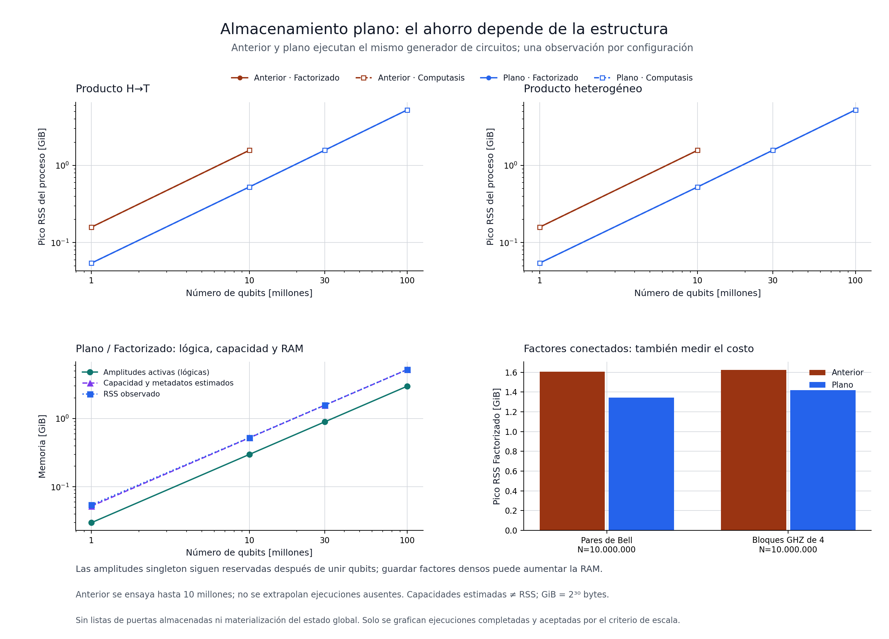
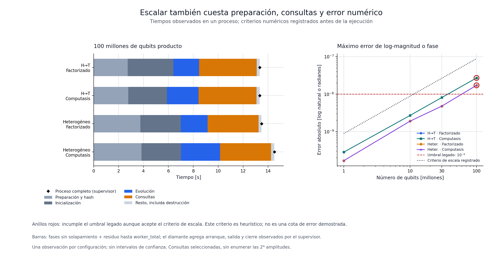
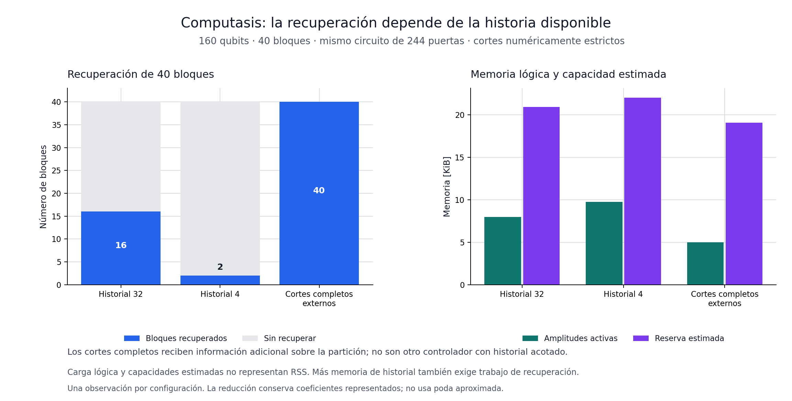

# Mundo X: escala y almacenamiento plano

> Registro histórico anterior a la eliminación del controlador. El código activo
> ya no incluye su implementación ni sus comandos. Las series con su nombre
> son mediciones archivadas; los supervisores actuales ejecutan los núcleos conservados.

18 de octubre de 2026. Rama local `codex/scale-exams-20261018`, sobre
`6b2d90b564726fe662889b01c649055f25b250b3`. Se conservan los informes del
[primer examen de límites](architecture_limits_2026-10-17.md) y de
[factorización y Computasis](factorized_exams_2026-10-17.md).

## Qué cambió

La idea y la arquitectura de Mundo X son del titular del proyecto. FactorizedCore
y Computasis son prototipos escritos en este trabajo para explorar esa propuesta.
Las medidas de este informe describen su implementación experimental actual.
Aer no es el motor de esos prototipos ni una dependencia de su núcleo nativo.

[`FactorizedCore`](../native/include/mundo_x/factorized_core.hpp) ahora almacena
los coeficientes de los qubits independientes en un buffer continuo. Cada
qubit conserva sus dos coeficientes complejos propios; no se comprimen todos
los productos HT en una fórmula ni se deduplican estados iguales.

El diseño anterior creaba un objeto y dos vectores por singleton. El nuevo
constructor hace cuatro asignaciones de buffers, tanto para un qubit como
para 100.000, y las puertas locales sobre los productos ensayados no asignan
memoria. Los factores entrelazados continúan utilizando bloques densos.

Los IDs de bloque son qubits representantes, y el primero en la lista de un
bloque lo identifica. Eso elimina la lista libre por qubit. Merge y split
preparan asignaciones y verificaciones antes del commit. Se mantiene la API
que utiliza Computasis.

En la plataforma examinada, para un producto y bloque máximo de 20:

```text
coeficientes singleton:     32 N bytes
lookup qubit → bloque/bit:  16 N bytes
slots de bloques:           8 N bytes
reserva estimada:           56 N + 336 bytes
payload lógico activo:     32 N bytes
```

`storage_estimate()` expone capacidades y metadatos estimados en O(1).
**No mide RSS.** Excluye asignador, buffers temporales, consultas, bibliotecas
y pila. Cuando los qubits se fusionan, su reserva singleton de 32 N permanece:
se informa como `retained_singleton_capacity_bytes`. Esa reserva puede hacer
que el nuevo diseño consuma más en familias con muchos bloques entrelazados.
El presupuesto sigue limitando amplitudes **lógicas activas**, no RAM total.

El nuevo [trabajador en flujo](../native/tests/factorized_stream_benchmark.cpp)
genera cada puerta al ejecutarla; no construye un vector con cientos de millones
de puertas. Se compila el mismo trabajador contra la versión anterior y la
nueva. Los hashes de circuitos y consultas permiten comprobar la coincidencia
entre las dos ejecuciones. El tiempo de generación de puertas está incluido en
evolución; el de calcular los hashes se registra aparte y entra en el tiempo
total.

## Resultado de escala

La suite principal completó **56 ejecuciones** bajo el criterio de escala
registrado previamente: 52 cumplen además el umbral numérico anterior y cuatro
solo el criterio de escala. Otras 20 entradas son omisiones del baseline por política
de tamaño; no se cuentan como pruebas aprobadas. Hubo cero eventos OOM. El smoke
final pasó **44/44** y la comprobación posterior de portabilidad **4/4**.

| Estado y motor | Payload lógico | Pico RSS del proceso | Inicialización / evolución / consultas |
|---|---:|---:|---:|
| HT, 10 millones, anterior | 320.000.000 B | 1,569 GiB | 1.232 / 230 / 571 ms |
| HT, 10 millones, plano | 320.000.000 B | 0,526 GiB | 302 / 210 / 474 ms |
| HT, 100 millones, plano | 3.200.000.000 B | 5,24 GiB | 3.676 / 2.071 / 4.629 ms |
| HT, 100 millones, Computasis | 3.200.000.000 B | 5,24 GiB | 3.110 / 2.533 / 4.663 ms |
| Heterogéneo, 100 millones, plano | 3.200.000.000 B | 5,24 GiB | 3.245 / 2.148 / 4.095 ms |
| Heterogéneo, 100 millones, Computasis | 3.200.000.000 B | 5,24 GiB | 3.163 / 3.151 / 4.088 ms |

En el HT de diez millones, con el mismo trabajador y las mismas consultas,
el RSS bajó aproximadamente **3 veces**. El mayor cambio de tiempo está en
inicialización. La evolución observada pasó de 230 a 210 ms: no se atribuye a
ella el ahorro total de memoria ni se presenta como una aceleración de tres veces.

El HT de cien millones tardó 13,337 s dentro del trabajador, incluyendo 2,386 s
del hash del circuito y 0,329 s del hash de consultas, además de preparación,
inicialización, evolución, consultas y destrucción. El proceso observado por
el supervisor tardó 13,340 s. Los otros ensayos de cien millones tardaron
aproximadamente 13,3–14,5 s. Se conservaron cien millones de factores y
doscientos millones de coeficientes; no se exportaron 2^100.000.000 amplitudes.

Los dos productos ensayados son HT homogéneo y ocho patrones locales repetidos
de H/X/T/S. El motor mantiene almacenamiento individual general por qubit,
pero este examen no recorre cien millones de estados locales distintos ni
estados arbitrarios entrelazados.



La reserva inactiva también se midió. Para diez millones de qubits Bell, el
payload fue 320 MB y quedaron otros 320 MB del buffer singleton retenido;
el RSS observado bajó de 1,724 a 1,444 GB. En grupos GHZ de cuatro qubits, el
RSS pasó de 1,744 a 1,524 GB con payload de 640 MB y reserva singleton inactiva
de 320 MB. El ahorro medido es menor que en los productos: la memoria retenida
y las asignaciones de bloques siguen costando.

Al permitir bloques de hasta 28, GHZ de **28 qubits** terminó: 4 GiB de
amplitudes activas, aproximadamente 6 GiB de pico RSS por las fusiones, 5,472 s
de evolución y 2,997 s de consultas. La ampliación de la guarda permite seguir
ese ensayo y deja visible el crecimiento exponencial del bloque denso.

## Corrección y seguridad de las operaciones

- El oráculo NumPy conservó tolerancia `3e-11`: **134 escenarios por modo,
  2.072 estados intermedios** y ocho consultas analíticas grandes. Error L2
  máximo `3.8355354298309724e-13`.
- Se añadieron casos de reutilización de slots, representante que queda a la
  derecha de un corte, bloques remotos, factores con gauge no normalizado,
  controles con fase global y consultas de ancho incorrecto.
- La suite del núcleo conserva sus **44.814 comprobaciones**. La nueva suite
  de almacenamiento pasó **2.590**, incluyendo **51 fallos de asignación
  inyectados**: merge y split conservan coeficientes, partición y contadores
  cuando no pueden reservar memoria. También pasó UBSan.
- El examen adversario del controlador pasó **12.528 comprobaciones**.
- CTest integrado pasó **7/7**. Son pruebas finitas; no una demostración para
  cualquier circuito.

La separación mantiene su criterio estricto de reconstrucción coeficiente por
coeficiente. Persiste el falso negativo conocido de algunos productos complejos
después de CX²/CZ² debido al redondeo. No se añade truncamiento aproximado.

## Precisión de las consultas grandes

El pequeño oráculo de vectores completos y los exámenes analíticos grandes
tienen criterios distintos. En productos de cien millones de qubits, un pequeño
error por coeficiente se acumula en el logaritmo de la amplitud global.

Antes de ejecutar la escala se registró este criterio heurístico:

```text
tolerancia_log_escala = min(1e-7, max(3e-11, 4 N epsilon_double))
diagnóstico_legacy = error_log <= 1e-8 y error_fase <= 1e-8
```

Es un criterio de examen, no una cota matemática rigurosa ni una modificación
de la precisión del motor. Se conservan error absoluto, umbral y resultado
del diagnóstico anterior en cada observación. Los valores locales y el oráculo
denso pequeño mantienen sus criterios separados.

Las cuatro ejecuciones de cien millones **incumplen el umbral anterior de
`1e-8`**. En HT, el error de logmagnitud fue `2.7106580091640353e-8` y el de fase
`6.709115041303448e-9`. En el producto heterogéneo fueron
`1.7209458746947348e-8` y `1.6771849846441977e-9`. Los cuatro cumplen el criterio
de escala preinscrito de `8.881784197001252e-8`. No se describe ese resultado
como mantener la tolerancia anterior.



Los productos heterogéneos incluyen ocho patrones de puertas. Las dos consultas
globales principales usan bitstrings elegidos a partir del soporte analítico;
así no terminan anticipadamente en un coeficiente cero. Un caso de amplitud
exactamente cero se verifica aparte. Las referencias usan únicamente ocho
estados locales en `long double` y conteos de patrones, sin un vector auxiliar
de referencia de tamaño exponencial.

Los productos grandes siguen teniendo amplitudes demasiado pequeñas para el
formato complejo ordinario. La consulta logarítmica representa magnitud y fase;
no repara pérdidas que hayan ocurrido dentro de un factor denso.

## Computasis: memoria limitada de las conexiones

Se prepararon 40 grupos disjuntos de cuatro qubits, cada uno con dos Bell.
Primero se aplicaron todos los puentes y después todas sus inversas. Los tres
métodos reciben las mismas **244 puertas sobre 160 qubits** y las mismas
consultas. Se verifica también la fase global `i`.

| Política | Grupos recuperados | Payload lógico final |
|---|---:|---:|
| Computasis, historial de 32 cortes | 16/40 | 8.192 B |
| Computasis, historial de 4 cortes | 2/40 | 9.984 B |
| Factorized con los 40 cortes proporcionados explícitamente | 40/40 | 5.120 B |

El historial almacena ambos lados de una conexión: 32 cortes pueden representar
solo 16 de estos puentes. Los otros se olvidan. Con historial de 32 hubo 728
intentos, 16 separaciones y 208 evicciones; con cuatro, 192 intentos, dos
separaciones y 236 evicciones. Se conservan las consultas y el estado previsto,
pero la partición final es menos compacta cuando falta información útil.

El comparador con cortes completos recibe información externa y no es un
controlador automático con el mismo límite de memoria. Sirve para medir qué
oportunidades pierde la política de historial. No se promete adaptación óptima.

Otro caso construye un clúster lineal de 21 qubits con bloque máximo de 20.
La puerta que excede la guarda se rechaza y el vector completo de entrada de
2^21 amplitudes permanece idéntico. Este estado admite una MPS de enlace 2:
la conectividad de los bloques por sí sola no reconoce toda la estructura útil.



## Cómo se mide y qué significa escalar

Cada trabajador de escala utiliza una CPU, hasta 8 GiB de espacio de direcciones
y 45 segundos. El cgroup dispone de 16 GiB. Un supervisor ejecuta un trabajador
por vez y conserva 2 GiB de margen observado; si se pierde, termina únicamente
su propio trabajador. Los procesos del usuario no se detienen ni se reconfiguran.

Se registran por separado: hash del circuito, inicialización, evolución en
flujo, preparación de bitstrings, consultas, validación, tiempo total y RSS
mediante `/proc/self/status` y observación del proceso. La destrucción del motor
está incluida en el tiempo total. Las mediciones son observaciones de un entorno
compartido, no estimaciones estadísticas de un récord.

La escala antigua se limita de antemano a tamaños que permiten una comparación
útil sin agotar memoria. Los casos omitidos por esa política se distinguen de
pruebas ejecutadas, fallos y límites alcanzados. Tampoco se interpreta una puerta
rechazada como circuito terminado.

La independencia tensorial es una propiedad del estado. El motor la conserva;
las puertas que conectan factores pueden exigir bloques de tamaño exponencial.
Representar cien millones de qubits producto no implica poder evolucionar
cualquier circuito entrelazado de ese tamaño.

## Registro histórico de una comparación externa

Se probó [Qiskit Aer MPS](https://qiskit.github.io/qiskit-aer/tutorials/7_matrix_product_state_method.html),
con Aer `0.17.2` y Qiskit `2.2.0`, además del stack actualizado Qiskit `2.6.0`
con el mismo Aer. En el índice de paquetes consultado, `0.17.2` y `2.6.0` eran
las versiones máximas disponibles de Aer y Qiskit, respectivamente; esa
observación se conserva, sin atribuirles un máximo rendimiento posible.

La herramienta utilizada para esa comparación histórica usó procesos nuevos, una CPU,
20 segundos y 2 GiB por trabajador. Se verifican hashes de las puertas pedidas y
tres observables Z en los mismos sitios. En el perfil controlado se compararon
también vectores completos pequeños contra un cálculo independiente: **75/75**
procesos correctos. En escala controlada hasta 100.000 hubo 44 ejecuciones
completas y 16 rechazos de Factorized/Computasis por su guarda de bloque.

Se mantuvo doble precisión, umbral MPS de truncamiento `0.0` y sin tope voluntario
de dimensión de enlace. También se ensayó un perfil con optimizaciones habituales:
fusión permitida y eliminación de qubits irrelevantes habilitada. El perfil
corregido de consultas de probabilidades pasó 20/20 en el stack inicial
(incluyendo diez casos pequeños que ejercitan el remapeo) y 10/10 ensayos de
10.000/100.000 en el stack actualizado.

Observaciones a **100.000 qubits**, con tres observables locales Z:

| Familia | Factorized: trabajo / RSS | Aer MPS actualizado y optimizado: trabajo / RSS |
|---|---:|---:|
| HT producto | 8,19 ms / 11,80 MiB | 2.984 ms / 334,46 MiB |
| Producto heterogéneo de ocho patrones | 15,11 ms / 13,83 MiB | 4.151 ms / 499,82 MiB |
| Pares Bell | 12,50 ms / 17,90 MiB | 1.574 ms / 242,37 MiB |
| GHZ | Rechazo al intentar ancho 21 | 2.063 ms / 450,04 MiB |
| Clúster lineal | Rechazo al intentar ancho 21 | 3.652 ms / 652,89 MiB |

La columna de trabajo incluye preparación del circuito, inicialización,
ejecución y consultas. Excluye el hash diagnóstico y arranque/importación;
ambos también están registrados y forman parte del tiempo de proceso completo.
El probe C++ de esta comparación almacena un circuito pequeño respecto al ensayo
de cien millones; no es el trabajador en flujo de la tabla anterior. No se
mezclan sus RSS o tiempos como si fueran un único experimento.

**Los trabajos internos difieren.** Con las tres Z solicitadas, el perfil
optimizado de Aer elimina qubits irrelevantes y conserva tres qubits en los
productos y seis en los pares Bell. En GHZ y clúster conserva los 100.000.
Factorized evoluciona todos sus factores. Se compara una tarea lógica solicitada,
no el rendimiento aislado de kernels realizando el mismo trabajo interno.
La interfaz Python, ensamblado, compilación y optimizaciones de Aer tienen costo;
estas cifras no permiten atribuir toda la diferencia a su representación MPS.

Aer calcula sus instrucciones de consulta dentro de `backend.run`; no expone
un tiempo nativo aislado de consulta aquí. Se deja como `null` y se registra
ejecución más consultas, en lugar de inventar esa separación.

El resultado delimitó el comportamiento del prototipo FactorizedCore en productos
y pares independientes. También registró casos que la referencia MPS resolvió y
que el prototipo rechazó con su configuración de bloques. Los otros motores de
Mundo X, como Compact, no fueron sustituidos ni seleccionados automáticamente
por esta comparación.

### Consultas y configuración externa que requirieron investigación

El primer perfil optimizado produjo resultados inesperados con
`save_expectation_value` cuando se remapeaban qubits: cuatro validaciones de
escala fallaron. Se conservaron esas salidas y no se usan como tiempos válidos.
Un reproducer de ocho configuraciones observó la diferencia entre ese camino
y `save_probabilities([q])`, tanto en MPS como en el backend statevector, con
ambas versiones de Qiskit probadas. Se limita la conclusión a esas APIs,
versiones y configuraciones; no se presenta como superioridad de arquitectura.

La comparación optimizada válida usa probabilidades locales y obtiene
`Z = 1 - 2 P(1)`, la misma observable que calcula Factorized. Los datos guardan
`profile`, versión y `query_backend` para distinguir los caminos. El stack
actualizado necesitó una precarga por proceso de su propia biblioteca OpenMP
para resolver un error de importación de TLS estático. Se preservan el fallo
original y el comando aplicado; no se modificaron bibliotecas del sistema ni
se trata ese problema de instalación como rendimiento del simulador.

## Reproducir

Compilación C++17 y pruebas integradas:

```sh
cmake -S . -B build -DCMAKE_BUILD_TYPE=Release
cmake --build build -j 1
ctest --test-dir build --output-on-failure
```

En Linux, CMake también construye `factorized_stream_benchmark`. El oráculo
necesita NumPy y regenerar las figuras requiere Matplotlib. Los supervisores
usan directorios de salida nuevos y un lock configurable. Por ejemplo:

```sh
python tools/factorized_oracle.py --out /tmp/mundox-oraculo-nuevo --compute-lock /tmp/mundox-examen.lock
python tools/scale_factorized_stream.py --smoke --output-dir /tmp/mundox-smoke-nuevo --compute-lock /tmp/mundox-examen.lock
```

El supervisor de escala usa solo el candidato por defecto. La entrega separada
de comparadores también contiene `source-baseline/`, con los headers nativos de
`6b2d90b` necesarios para repetir la comparación entre versiones propias sin Git.
No incluye herramientas de simuladores externos. Desde `source/`:

```sh
python tools/scale_factorized_stream.py --full --baseline-repo ../source-baseline --output-dir /tmp/mundox-escala-nueva --compute-lock /tmp/mundox-examen.lock
```

Este perfil necesita Linux con un cgroup de memoria finito y margen suficiente
para los límites declarados. El CLI de demostración conserva su tope de 100.000
qubits y defaults anteriores; el trabajador de escala admite cien millones.
La ausencia de un checkout Git o del ejecutable Git no impide ejecutar el
supervisor. Los metadatos de revisión son `null` cuando no están disponibles.

Las herramientas y los archivos de requisitos de la comparación externa se
archivan fuera del repositorio, por petición del titular del proyecto, en
`/workspace/scratch/mundox-scale-20261018/external-tools-archive`.
Se conservan sus resultados históricos en este informe. El smoke externo pasó
3/3 y el segundo intento conservó todos los hashes de la evidencia; esto describe
aquella comprobación, sin incorporar esas herramientas al núcleo de Mundo X.

Para regenerar las figuras desde el código del paquete:

```sh
python tools/plot_scale_exams.py --stream ../evidence/full-stream-01/results.jsonl --controller ../evidence/controller-scale/results.json --output-dir /tmp/mundox-graficas-nuevas
```

## Evidencia y alcance

La entrega corregida contiene las fuentes actuales, los headers nativos de la
versión previa y la evidencia de las pruebas del núcleo propio, con comandos,
hashes y manifiesto SHA-256. Los comparadores externos, sus requisitos y sus
archivos de reproducción quedan archivados aparte. No contiene ejecutables ni
entornos Python.
El [resumen JSON](scale_exams_summary_2026-10-18.json) reúne contadores,
observaciones seleccionadas, criterios y hashes de las fuentes finales.

- `full-stream-01/`: 56 ejecuciones y 20 omisiones, con hashes y snapshots.
- `smoke-stream-final-02/`: 44 exámenes con las guardas finales del trabajador.
- `portable-smoke-03/`: cuatro comprobaciones con defaults portables.
- `correctness-final01/`: oráculo NumPy, semillas, casos y métricas.
- `engine/`: almacenamiento, fallos de asignación inyectados y UBSan.
- `controller-scale/`: historial limitado, cortes completos y clúster lineal.
- `integration/`: compilación, CTest y CLI.
- `native-only-check/`: compilación y pruebas tras retirar comparadores externos.

La evidencia de las comparaciones externas y la comprobación anterior de
exportación se conservan fuera de esta entrega, en el archivo de trabajo;
las tablas anteriores son el registro histórico de esos ensayos.

Después de la suite grande se reforzó el guard del oráculo del trabajador para
rechazar explícitamente `NaN` y longitudes incorrectas, y se restringieron pares
Bell a tamaños pares para que ambas consultas principales tengan soporte. Los
casos grandes ya usaban Bell par. El diff y las fuentes previas se preservan;
los cambios se verificaron con el smoke final sin sustituir la evidencia grande.
Los defaults de rutas se hicieron portables después, sin modificar la evolución.

La reducción de metadatos y el flujo de puertas son mejoras de implementación
medidas en Mundo X. Los productos tensoriales y las MPS son técnicas conocidas.
Estas pruebas no determinan prioridad científica, superioridad sobre todos los
simuladores ni computación cuántica física. Un selector de representaciones fue
una opción estudiada, no un plan adoptado. La línea de trabajo continúa sobre
el núcleo propio de Mundo X y sus límites medidos.

El repositorio original y las dos ramas previas permanecen intactos. Los nuevos
cambios se guardan localmente; no se publicaron ni se hizo push.
